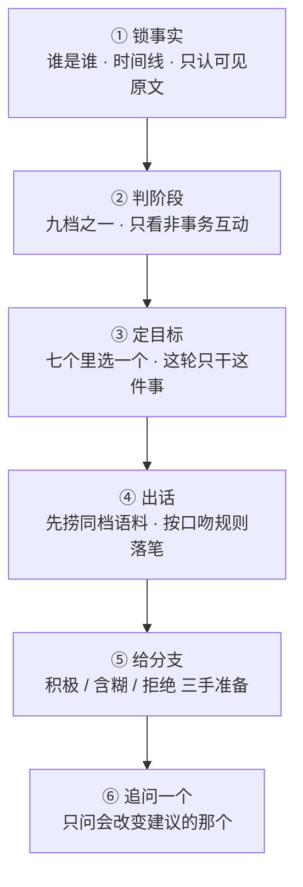

<div align="center">

# 恋爱军师

**给 AI 用的恋爱对话参谋 skill**

把聊天记录贴进来 判断对方什么意思 给出能直接复制发出去的那一句

[](LICENSE)


</div>

---

> 它不是话术生成器 也不是情感客服
>
> 定位是坐在你旁边 跟你一起把聊天记录往下翻的那个人

## 目录

- [一分钟看懂](#一分钟看懂)
- [它到底怎么工作](#它到底怎么工作)
- [九档阶段](#九档阶段)
- [七种目标 每轮只选一个](#七种目标-每轮只选一个)
- [快速开始](#快速开始)
- [六条命令](#六条命令)
- [语料格式](#语料格式)
- [语气规则](#语气规则)
- [发之前的九项自检](#发之前的九项自检)
- [目录结构](#目录结构)
- [已知限制](#已知限制)
- [常见问题](#常见问题)
- [许可](#许可)

## 一分钟看懂

一句话区分它和市面上的话术库：

| | 一般话术库 | 这个 skill |
|---|---|---|
| 起点 | 先给你句子 | 先判这一轮处在什么阶段 |
| 单位 | 一次给十个备选 | 一轮只做一件事 主推一条 |
| 语法 | 教材腔 工整 完整 | 真人打字腔 碎 标点不全 |
| 依据 | 作者的经验 | 真人私聊实录的节奏统计 |
| 边界 | 什么都能答 | 该收线时告诉你收线 |

三件它一定会做的事：

1. **判阶段** 固定九档 不自创「暧昧升温期」这种中间态
2. **定目标** 承接 降压 调侃 轻推 约见 澄清 收线 里只挑一个
3. **出话前先捞料** 从语料库取 2 到 3 段同阶段同形态的真实对话 看完断句再动笔

## 它到底怎么工作

每次对话走固定六步 顺序不能颠倒：



### ① 锁事实

先做四件事：锁说话人映射、排时间线、只把可见原文当事实、不补线下动作和内心独白。

> 回复快慢、表情、偶尔秒回 都不能单独当兴趣证据。她可能在忙 也可能在疏远 单条消息上这两种长得一模一样。

### ② 判阶段

用固定九档。下面这些**都不算**升级信号：

- 办事往来、求你帮忙、认真回复、说谢谢
- 顺路碰面、因为工作见过、群体局
- 回得快、用了表情、深夜聊过一次
- 「哥」「宝」这类称呼

### ③ 定目标

一句回复里同时安慰、调情、邀约、要解释 重点一定会消失。要拆就分几轮，别塞在一条里。

### ④ 出话

硬约束：能直接复制、只用对话里已有信息、主推一条、长度跟着对方、少标点。

> 最典型的错：她回来一周了 你说「庆祝你回来」 可「庆祝」这个前情根本不存在。

### ⑤ 给分支

每条消息后面都想好三种回法：积极就加温一小步，含糊就不在同一轮追问，拒绝就停。

### ⑥ 追问一个

只问真正会改变建议的那一个。不凑数。

## 九档阶段

| 档位 | 判据看什么 | 这档通常做什么 |
|---|---|---|
| 初识 | 有非事务往来 还没有私人话题 | 轻推、约见 |
| 暧昧 | 有试探 有回抛 有私人信息交换 但没确立 | 调侃、轻推 |
| 热恋 | 已确立 高频 称呼升级 | 承接、调侃 |
| 冲突 | 有具体分歧 情绪高 | 降压、澄清 |
| 冷淡 | 单边投入 回应稀薄 事务化 | 降压、收线 |
| 异地 | 已确立但分隔 靠约定和节奏维持 | 承接、约见 |
| 挽回 | 分手后主动求回 | 收线、澄清 |
| 谈婚论嫁 | 已经进入现实议题 | 澄清、收线 |
| 日常 | 兜底 轮数不足或判不了档 | 承接 |

> 分手后还保持联系的 属于挽回档的子情形 但**不要按挽回的话术走**。见 `references/阶段与卡点.md`「分手后」一节：复合、维持、收线三条路要分开走。
>
> 表只给方向 判档靠人。脚本管形制 管不了判断对错；阶段判错 话术再干净也是错的。

## 七种目标 每轮只选一个

| 策略 | 什么时候用 | 这轮只完成 |
|---|---|---|
| 承接 | 她在倾诉、受挫、兴奋、分享 | 让她感到内容被听见 |
| 降压 | 她忙、累、冷、回避，或你刚追问太多 | 停止追加，留一个无压力窗口 |
| 调侃 | 她接梗、反问、斗嘴、主动延展 | 加一点张力，把球抛回去 |
| 轻推 | 聊得顺但原地打转 | 往前挪一小步，不要承诺 |
| 约见 | 有共同兴趣、时间窗口、已接住软邀约 | 落到具体、低压力见面 |
| 澄清 | 信息矛盾、期待不明、一个未知会改变决策 | 只问清一个关键事实 |
| 收线 | 单边投入、反复取消、明确拒绝、边界不合 | 停止无效供给 |

## 快速开始

**一 放进 skills 目录**

把 `lianai-junshi` 整个目录拷进去。Doubao 的路径是：

```text
<workspace>/.user_skills/lianai-junshi
```

脚本全部用相对路径，拷到哪都能跑；只依赖 Python 3 标准库，不需要 pip 装任何东西。

**二 确认能读到语料**

```bash
cd lianai-junshi
python scripts/取料.py --list
```

**三 开始用**

把聊天记录或截图描述贴给 agent，说清楚「谁是谁」。剩下的按六步走。

## 六条命令

| 命令 | 干什么 |
|---|---|
| `取料.py --list` | 看语料库有哪些阶段、句式、结果可取 |
| `取料.py --stage ...` | 按阶段 / 性格 / 句式捞真实对话 |
| `检查话术.py` | 九项形制自检，不合格返回非 0 |
| `防重复.py` | 连发多条时的模板味检测 |
| `检查skill.py` | skill 自身的结构自检 |
| `--brief` | 只出短摘要，不铺全文 |

### 捞料

```bash
python scripts/取料.py --list
python scripts/取料.py --stage 冲突 --tag 女性格:戏多 --n 3
python scripts/取料.py --stage 暧昧 --style 碎片连发 --n 3 --brief
```

`--list` 的真实输出（公开版只带 3 段脱敏示例）：

```text
可用阶段（3 段）：
  日常     1
  冷淡     1
  挽回     1

句式：
  pattern  碎片连发(2)、长段(1)
  punct    无标点(1)、半标点(1)、空格断句(1)

结果：
  成了(1)、悬着(1)、没成(1)
```

捞出来的样子是这样，注意它不是给你抄的：

```text
男方：早啊
男方：今天闭幕式抢冰墩墩哈哈
女方：[狗头表情]
男方：能不能得倒它就看今天三点了
女方：抢的途径是什么啊，奥林匹克官方旗舰店吗
男方：淘宝直接搜冰墩墩
女方：那我也准备着
```

> 当锚点 不当模板。学的是节奏和口气，不是台词。那些是别人的私聊，句子不能原样搬给另一个人。

### 检查话术

```bash
python scripts/检查话术.py --text "你要发的话" --peer 对方最后一条的字数
```

`--peer` 是对方最后一条的字数，用来判断你这条是不是回了人家三倍长。

## 语料格式

一行一段 JSON。想加自己的记录，按这个格式追加就行：

```json
{
  "id": "E001",
  "source": "公开网络，已脱敏",
  "stage": "日常",
  "stage_method": "人工标注",
  "turn_count": 48,
  "turns": [["我", "早起床"], ["他", "早啊"], ["他", "今天闭幕式抢冰墩墩哈哈"]],
  "style": {"msg_count": 48, "len_avg": 11, "len_max": 26, "pattern": "碎片连发", "punct": "半标点", "inverted": false},
  "roles": {"男": "他", "女": "我"},
  "roles_conf": "ok"
}
```

| 字段 | 说明 |
|---|---|
| `id` | 唯一编号 |
| `source` | 来源说明 |
| `stage` | 九档之一 |
| `stage_method` | 人工标注 / 规则匹配 |
| `turn_count` | 轮数 |
| `turns` | `[["说话人","原话"], ...]`，库内统一用 `我` / `他` / `她` |
| `style` | `{msg_count, len_avg, len_max, pattern, punct, inverted}` |
| `roles` | 说话人映射 `{"男":"他","女":"我"}` |
| `roles_conf` | `ok` 表示性别已核，其他值会被工具跳过 |

`style.pattern` 取值：短句、碎片连发、中长句、长段
`style.punct` 取值：半标点、空格断句、无标点、问号多、全标点、省略号多

> 用你自己的聊天记录建库时，先把昵称、城市、学校、公司这类能对应到活人的信息清掉。

## 语气规则

整条规则只从一组统计里长出来——**真人打字是碎的 标点是不全的**。

从 208 段实录里数出来的形态分布：

| 打字形态 | 段数 |
|---|---|
| 短句 | 102 |
| 碎片连发 | 51 |
| 中长句 | 38 |
| 长段 | 5 |

| 标点习惯 | 段数 |
|---|---|
| 半标点 | 62 |
| 空格断句 | 53 |
| 无标点 | 45 |
| 问号多 | 18 |
| 全标点 | 15 |
| 省略号多 | 3 |

空格断句加无标点合计 98 段，占 47%。所以下面七条是硬规则，不是风格建议：

1. 句号一个不打
2. 逗号改成空格
3. 问号只打一个，不打「？？」「？！」
4. 超过 25 字拆成两条发
5. 不打包号、书名号、引号、破折号
6. 表情跟着对方，一条最多一个
7. 分点符号、列表符号一律不用

连发多条还要过三道关：换开头（别连着用「那」「嗯」「行」「我」起手）、别全是陈述句、称呼跟上对方的进度。

细则在 `references/口吻.md`「标点」一节。

## 发之前的九项自检

```bash
python scripts/检查话术.py --text "你要发的话" --peer 8
```

| # | 查什么 |
|---|---|
| 1 | 能不能直接发 |
| 2 | 是不是给了 ABC 三套方案 |
| 3 | 和对方那条长度差几倍 |
| 4 | 几个问号 |
| 5 | 有没有客服腔 |
| 6 | 有没有空心词（「我会一直陪着你」这类） |
| 7 | 标点像不像私聊 |
| 8 | 有没有分点符号 |
| 9 | 里面有没有你自己的东西，还是全是问句和关心 |

有名错误就返回非 0，改到干净为止。

> 这条命令是兜底用的：说实话的时候它拦得住，说空话的时候它拦不住。它只管形，不管内容真假。

## 目录结构

```text
lianai-junshi/
├── SKILL.md                  主流程六步 + 按需加载表（agent 读的入口）
├── references/
│   ├── 阶段与卡点.md          九档定义、升级条件、卡点表、红黄绿灯、分手后情形
│   ├── 口吻.md               语气、长度、标点七条、黑名单
│   ├── 生成器.md             一句话怎么生成、三档改写
│   └── 边界.md               拒绝、危机、不能做的事
├── knowledge/
│   ├── 00-怎么用.md           索引，按处境找单篇
│   ├── 01-梗与情话.md         梗、情话说到哪一档
│   ├── 02-开场与接话.md       从零开场 接到话怎么续
│   ├── 03-处境指南.md         常见处境怎么处理
│   ├── 04-翻车案例.md         别人怎么谈崩的
│   └── 05-语气对照.md         24 组左右对照，念着改
├── scripts/
│   ├── 取料.py               按阶段 / 性格 / 句式捞实录
│   ├── 检查话术.py           九项形制自检
│   ├── 防重复.py             连发模板味检测
│   ├── 检查库.py             语料库体检
│   ├── 检查skill.py          结构自检
│   └── paths.py              路径解析（全相对）
├── data/
│   └── 新增素材.jsonl         公开版 3 段脱敏示例，共 94 轮
├── README.md
└── LICENSE
```

知识库和实录冲突时，一律以实录为准：知识库给结构和分寸，实录给口气。

## 已知限制

| 限制 | 说明 |
|---|---|
| 谈婚论嫁、见家长两档是零 | 公开网页源里这类帖全是纯叙述，没有带对话截图的可采 |
| 判档靠人 | 脚本只管形制，管不了阶段判断对错 |
| 语料是别人的私聊 | 只能当语气锚点，不能原样发给另一个人 |
| 性别标注不全 | 截图看不出谁是谁时就不标，宁缺不错 |
| 公开版只有 3 段 | 全量 208 段含他人可识别信息，不公开；骨架和方法都在，空库也能跑，只是少语气锚点 |

## 常见问题

<details>
<summary>为什么不多放一些语料</summary>

那 208 段是从公开网络搜集的真人私聊，里面有昵称、城市、学校、公司这类能对应到具体人的信息。公开发布等于传播别人的隐私，机械替换也漏得住。所以只留 3 段已经处理过的示例。

你要的是方法，不是别人的私聊。

</details>

<details>
<summary>没有语料库还能用吗</summary>

能。判阶段、定目标、出话的结构都在。缺的只是「看一眼真人怎么断句」这一层，脚本的零命中会自己放宽条件重试，仍然捞不到就按 `references/口吻.md` 的形态分布自己控制长度和标点。

</details>

<details>
<summary>它会不会直接给我一段情话让我发</summary>

不会。它先问你谁是谁、聊到哪一步，再给这一轮的一条。要的是能发出去且不出事，不是好看。

</details>

<details>
<summary>能不能用来判断「还有没有戏」</summary>

能，而且它倾向于说没有戏。单边投入、反复取消、明确拒绝、边界不合，会给收线而不是再等等看。

</details>

<details>
<summary>支持哪些 agent</summary>

任何能读 `SKILL.md` 并调用本地脚本的 agent 环境。Doubao、Claude Code 这类放进去就能用。

</details>

## 许可

MIT，见 [LICENSE](LICENSE)。

---

<div align="center">
<sub>「目标是让他不亏 不是让他把到谁」</sub>
</div>
